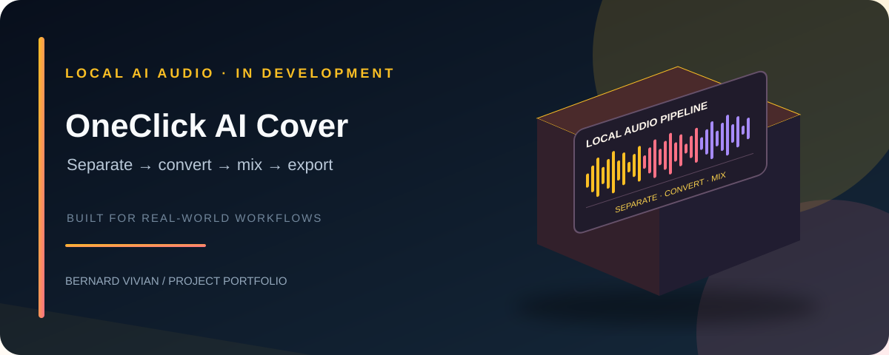
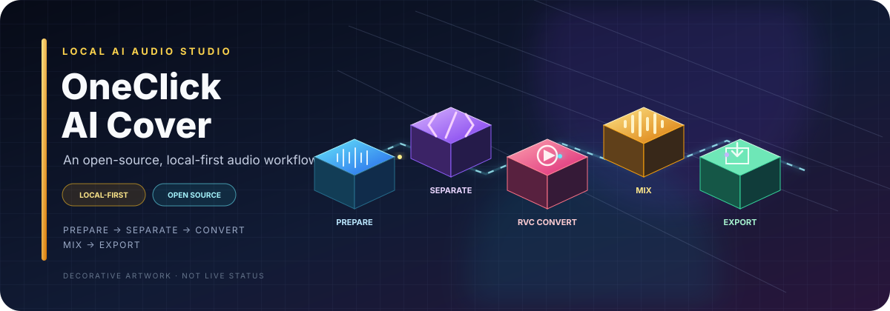

<p align="center">
  
</p>

<h1 align="center">OneClick-AI-Cover</h1>
<p align="center"><strong>A local-first, Windows-first AI singing-cover workflow.</strong><br/>Separate vocals · Convert with RVC · Remix · Export</p>

<p align="center">
  <a href="https://github.com/ViviBeri/OneClick-AI-Cover/actions/workflows/windows-checks.yml"></a>
  <a href="https://github.com/ViviBeri/OneClick-AI-Cover/actions/workflows/tests.yml"></a>
  
  
  
</p>

> **Project status: integration build.** The current `main` branch passes its Linux test suite and Windows smoke checks on Python 3.11 and 3.12. Real Demucs inference, pinned RVC asset verification, headless Gradio startup, and browser callback checks are included in Windows CI. A clean-machine installation and a complete real RVC conversion with an authorized checkpoint are still pending. The 3D-style banner is decorative project artwork; the application itself is a local Gradio interface.

---

## Zero-budget commitment

**The core application is intended to remain free to use.** The default workflow runs on your own Windows PC and does not require a subscription, paid API key, hosted inference service, or cloud GPU.

- **No paid AI API:** Demucs and the RVC inference backend run locally; the app does not call a metered commercial AI endpoint.
- **No cloud backend dependency:** accounts, cloud databases, and hosted processing are not required.
- **No required paid hosting:** the desktop application and its local API run on your computer.
- **Free model discovery:** public Hugging Face model search is optional and uses public model-card metadata; availability and downloads remain subject to the provider's policies and rate limits.
- **Open-source components:** the project uses third-party software and model assets with their own licenses and terms. See [third-party licenses](docs/THIRD_PARTY.md).

The project does not promise that every way of using it has zero real-world cost. You provide the computer, electricity, internet connection, storage, and any voice model you choose. We will not add a paid API, cloud GPU, or mandatory subscription to the core local workflow.

## Support this project

If this project is useful to you, consider [sponsoring my open-source work](https://github.com/sponsors/ViviBeri). Your support helps fund ongoing maintenance, testing, documentation, and future improvements.


## What it does

OneClick-AI-Cover is designed to take an audio track through a local workflow:

<p align="center">
  
</p>

<p align="center"><sub>The animated 3D workflow is README artwork. It is not a live application preview or a claim that end-to-end conversion has been verified.</sub></p>

| Stage | What happens |
|---|---|
| **01 · Prepare** | Validate the selected MP3, WAV, or FLAC file and prepare audio for processing. |
| **02 · Separate** | Demucs separates vocals from the instrumental. |
| **03 · Convert** | The RVC adapter uses a compatible, inference-ready `.pth` model. |
| **04 · Mix** | Converted vocals are sample-rate matched and mixed with the instrumental. |
| **05 · Export** | Save a WAV file or choose optional MP3 export through FFmpeg. |

### Free public model browser

The **Free Model Browser** tab optionally searches public Hugging Face model-card metadata and downloads a user-selected public `.pth` file. No Hub token or paid inference endpoint is required. Public Hub access remains subject to Hugging Face's current rate limits, bandwidth policies, and repository terms. Review the model card, license, and voice permissions before downloading. Downloads are quarantined under `models/unverified/` and do not become selectable until separately imported. The **Model Preflight** tab scans selected `.pth` ZIP metadata without calling `pickle.load()` or `torch.load()`. It reports common RVC marker strings only; it cannot validate tensor dimensions, certify compatibility, or make a model safe. Import and generation require a separate explicit trust acknowledgement. That acknowledgement is not a sandbox: the RVC backend may deserialize pickle payloads while loading a checkpoint. Use only files from publishers you personally trust. Local manual model import remains available.

See the [local job history guide](docs/LOCAL_JOB_HISTORY.md) for SQLite persistence and restart behavior. See the [RVC retrieval index guide](docs/RVC_INDEXES.md) for optional index import and tuning. See [free-tier architecture](docs/FREE_TIER_ARCHITECTURE.md) for the privacy, licensing, and model-safety boundaries. See the [web-first, local-first hybrid architecture](docs/WEB_HYBRID_ARCHITECTURE.md) for the deployment decision and future remote-processing requirements.

### Highlights

- **Local-first processing:** the app runs on your machine; it does not automatically upload your song or recordings to a cloud service.
- **Persistent job metadata:** the local API stores job status and history in SQLite at `data/jobs.sqlite3`; interrupted jobs are marked failed on restart rather than silently resumed.
- **Audio input:** MP3, WAV and FLAC are supported by the input flow.
- **Vocal separation:** Demucs is used to create vocal and instrumental tracks.
- **Voice conversion:** a command-line adapter invokes a compatible RVC inference backend and model.
- **Audio mixing:** converted vocals are sample-rate matched and mixed with the instrumental.
- **Export:** WAV output, with optional MP3 export through FFmpeg.
- **Voice utilities:** import an inference-ready `.pth` model, optionally import its matching RVC `.index` retrieval file, configure index strength, and prepare voice recordings as mono WAV files. Model import and generation are guarded by explicit checkpoint-trust confirmation.
- **Experimental training access:** a tab can launch the upstream RVC training interface; this is not yet a one-click training pipeline.

## Quick start (Windows)

1. Download the repository as a ZIP and extract it to a folder you can write to.
2. Connect to the internet and run `install.bat`.
3. Wait for the installer to set up the managed Python runtimes, pinned CPU PyTorch/Demucs dependencies, pinned RVC backend, and required HuBERT/RMVPE inference assets. The installer verifies the downloaded asset sizes and checksums. This can take a while and uses several GB of disk space.
4. Run `run.bat` to open the local Gradio interface.
5. Add an inference-ready RVC voice model you are authorized to use under `models/voices/`.
6. Select an input song and model, choose WAV or MP3, and click **Generate cover**.

Python does not need to be installed manually. Keep the complete terminal output if installation fails; see [Troubleshooting](docs/troubleshooting.md).

## Architecture

```text
Audio file (MP3 / WAV / FLAC)
             |
             v
     Validate and prepare
             |
             v
     Demucs separation
       /           \
      v             v
   Vocals       Instrumental
      |
      v
   RVC inference + compatible .pth model
      |
      v
 Sample-rate matching -> Mix -> WAV / optional MP3
```

The main interface is in `app.py`. Application modules live in `src/oneclick_cover/`; the RVC adapter and Demucs runner are under `scripts/`. Automated regression tests are in `tests/`. The animated README artwork is built from `readme-hero.svg` and `readme-pipeline-3d.svg`. Both are lightweight SVG assets and are **not runtime dependencies**. The app itself remains a Gradio interface; the 3D artwork is documentation only, not a 3D application UI.

## Verification status

| Area | Current status | Evidence / next step |
|---|---|---|
| Source checks and automated regression tests | **Passed on current main** | [Tests run #42655809246](https://github.com/ViviBeri/OneClick-AI-Cover/actions/runs/42655809246) — Python 3.11 and 3.12. |
| Windows dependency/import and startup checks | **Passed on current main** | [Windows Checks run #42655809194](https://github.com/ViviBeri/OneClick-AI-Cover/actions/runs/42655809194) — Python 3.11 and 3.12. |
| Pinned HuBERT/RMVPE downloads and checksum verification | **Passed on Windows CI (Python 3.11)** | All four assets passed size and SHA-256 verification in [Windows Checks run #42493399061](https://github.com/ViviBeri/OneClick-AI-Cover/actions/runs/42493399061); the current Windows workflow runs this download once to avoid duplicate downloads. |
| Static model preflight, quarantine, and trust-acknowledgement regression tests | **Passed on current main** | Included in [Tests run #42655809246](https://github.com/ViviBeri/OneClick-AI-Cover/actions/runs/42655809246). |
| Clean Windows 10/11 x64 installation | **Pending manual verification** | [Issue #1](https://github.com/ViviBeri/OneClick-AI-Cover/issues/1) |
| Managed FFmpeg MP3 import/export on Windows | **Pending manual verification** | [Issue #2](https://github.com/ViviBeri/OneClick-AI-Cover/issues/2) |
| Full authorized-audio conversion (Demucs → RVC → mix → export) | **Pending manual verification** | [Issue #3](https://github.com/ViviBeri/OneClick-AI-Cover/issues/3) |
| Clean uninstall / app-managed file removal | **Pending** | [Verification plan](docs/verification.md#section-6-uninstall-verification) |
| Signed release installer and official SHA-256 | **Not published** | No versioned release artifact is available yet |

Automated tests cover sample-rate matching, mono-vocal mixing, stale or invalid RVC output rejection, mocked success/failure paths for Demucs/RVC/MP3 export, stale-file cleanup after FFmpeg failures, partial job-folder cleanup, model quarantine, static checkpoint preflight, checkpoint-trust guards, UI-independent pipeline execution, and local job-state transitions. The local authenticated HTTP API now starts and stops with the desktop app. Browser-to-API integration, upload handling, and UI polling/cancellation remain pending. Windows CI additionally runs real Demucs inference and a Gradio browser callback smoke test. **Mocked RVC pipeline tests do not prove real RVC inference, sound quality, or end-to-end conversion.** A green CI run is not a substitute for a clean-machine installation test.

See the [verification plan](docs/verification.md) and [evidence template](verification-results/TEMPLATE.md). Do not mark a manual verification item complete until the acceptance criteria and evidence are recorded.

## Hardware expectations

- **Minimum starting point:** Windows 10/11 x64 and 8 GB RAM; this is not a guarantee that inference will run smoothly.
- **Recommended:** 16 GB RAM or more and a compatible NVIDIA GPU for practical inference speed.
- **CPU-only / older hardware:** separation and conversion may be very slow or may run out of memory.
- **Voice training:** substantially more demanding than using an existing model. The training tab launches the upstream RVC interface; dataset preparation and training are not fully automated here.

The installer and inference backend use separate managed Python environments. Installation downloads large third-party dependencies, so use a stable internet connection and allow several GB of free disk space. Windows 10 version 1903 is old; use a supported, updated operating system where possible.

## Prepare or train a voice

1. Open **Prepare Voice Recordings** to convert supported recordings into mono WAV files in a local dataset folder.
2. Open **Train My Voice (Experimental)** to launch the upstream RVC training interface.
3. Follow the upstream RVC preprocessing, feature extraction, training, and index workflow.
4. Export an inference-ready model and import the `.pth` file into OneClick-AI-Cover.

This remains an advanced, partly manual workflow. The [voice-training guide](docs/voice-training.md), [remote-training guide](docs/remote-training.md), and [Kaggle preflight notebook](notebooks/kaggle_rvc_training_preflight.ipynb) explain the current scope. The notebook is a backend/environment preflight, **not** a complete hosted training pipeline. Free GPU availability is limited.

## Project documentation

<details>
<summary><strong>Setup, verification, and troubleshooting</strong></summary>

- [Installation and troubleshooting](docs/troubleshooting.md)
- [Verification checklist](docs/verification.md)

</details>

<details>
<summary><strong>Voice models and training</strong></summary>

- [Voice training](docs/voice-training.md)
- [Remote training options](docs/remote-training.md)

</details>

<details>
<summary><strong>Safety, licenses, and contributions</strong></summary>

- [Legal and ethical use](docs/ETHICS_AND_LEGAL.md)
- [Third-party dependencies and licenses](docs/THIRD_PARTY.md)
- [Community guidelines](docs/COMMUNITY.md)
- [Contributing](CONTRIBUTING.md)
- [Security policy](SECURITY.md)

</details>

## Engineering build log

- [Build Log 01 — Designing a Local-First AI Audio Workflow](docs/BUILD_LOG_01_LOCAL_AI_AUDIO_WORKFLOW.md): pipeline architecture, model handling boundaries, failure checks, CI scope, and remaining real-world verification.

## Roadmap

- [x] Local Gradio starter UI and audio-processing modules
- [x] Managed Python setup script and pinned RVC backend
- [x] Audio input preparation and optional FFmpeg MP3 export
- [x] Voice-model import and recording preparation tools
- [x] Windows CI checks and automated regression tests
- [x] Failure handling and stale output cleanup
- [x] Public model download quarantine and regression tests
- [x] Static non-deserializing RVC checkpoint preflight and regression tests
- [x] Explicit trust acknowledgement before checkpoint import and generation
- [ ] Verify installer on a clean Windows machine
- [ ] Verify full conversion with authorized audio and a compatible model
- [ ] Benchmark memory, CPU and GPU performance and define low-resource profiles
- [x] Extract the local processing pipeline from Gradio handlers and add a tested process-local job state store
- [ ] Add a local job API and connect the UI to job status, cancellation, and result retrieval
- [ ] Redesign the responsive browser UI while retaining local processing
- [ ] Evaluate optional remote inference only after privacy, security, consent, and cost requirements are met
- [ ] Complete and verify remote training/checkpoint export workflow
- [ ] Package a reproducible Windows release and publish its checksum

## Responsible use

Use only audio and voices you own or have explicit permission to use. Do not create deceptive impersonations or abusive/non-consensual audio. Disclose synthetic audio when people could mistake it for a real performance or statement. Local processing does not remove copyright or consent obligations.

No voice models or copyrighted songs are bundled. Third-party dependencies and model weights have their own license terms. The MIT license applies to the project's original code; see [LICENSE](LICENSE).

---

<p align="center"><sub>Built as an evolving local AI audio project · Feedback and reproducible bug reports are welcome.</sub></p>
