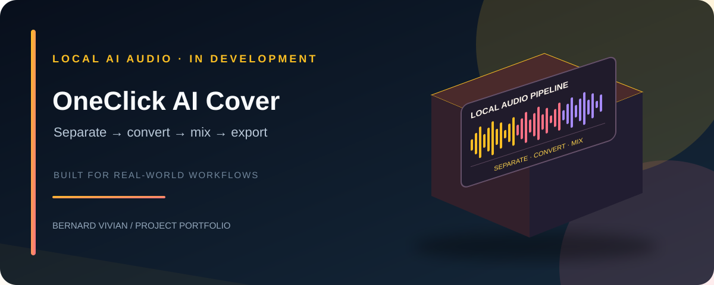
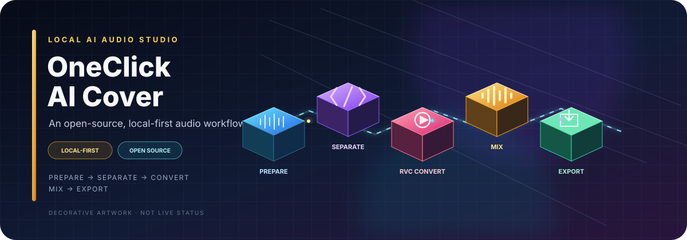

<p align="center">
  
</p>

<h1 align="center">OneClick-AI-Cover</h1>
<p align="center"><strong>A local-first, Windows-first AI singing-cover workflow.</strong><br/>Separate vocals · Convert with RVC · Remix · Export</p>

<p align="center">
  <a href="https://github.com/ViviBeri/OneClick-AI-Cover/actions/workflows/windows-checks.yml"></a>
  <a href="https://github.com/ViviBeri/OneClick-AI-Cover/actions/workflows/tests.yml"></a>
  
  
  
</p>

> **Project status: early integration build.** The UI and processing stages are integrated with automated regression coverage, but clean-machine installation and a complete real-audio conversion have not yet been verified. The 3D-style banner is decorative project artwork; the application itself is a local Gradio interface.

## What it does

OneClick-AI-Cover is designed to take an audio track through a local workflow:

<p align="center">
  
</p>

<p align="center"><sub>The animated 3D workflow is README artwork. It is not a live application preview or a claim that end-to-end conversion has been verified.</sub></p>

| Stage | What happens |
|---|---|
| **01 · Prepare** | Validate the selected MP3, WAV, or FLAC file and prepare audio for processing. |
| **02 · Separate** | Demucs separates vocals from the instrumental. |
| **03 · Convert** | The RVC adapter uses a compatible, inference-ready `.pth` model. |
| **04 · Mix** | Converted vocals are sample-rate matched and mixed with the instrumental. |
| **05 · Export** | Save a WAV file or choose optional MP3 export through FFmpeg. |

### Highlights

- **Local-first processing:** the app runs on your machine; it does not automatically upload your song or recordings to a cloud service.
- **Audio input:** MP3, WAV and FLAC are supported by the input flow.
- **Vocal separation:** Demucs is used to create vocal and instrumental tracks.
- **Voice conversion:** a command-line adapter invokes a compatible RVC inference backend and model.
- **Audio mixing:** converted vocals are sample-rate matched and mixed with the instrumental.
- **Export:** WAV output, with optional MP3 export through FFmpeg.
- **Voice utilities:** import an inference-ready `.pth` model and prepare voice recordings as mono WAV files.
- **Experimental training access:** a tab can launch the upstream RVC training interface; this is not yet a one-click training pipeline.

## Quick start (Windows)

1. Download the repository as a ZIP and extract it to a folder you can write to.
2. Connect to the internet and run `install.bat`.
3. Wait for the installer to set up the managed Python runtimes, app dependencies, and pinned RVC backend. This can take a while and uses several GB of disk space.
4. Run `run.bat` to open the local Gradio interface.
5. Add an inference-ready RVC voice model you are authorized to use under `models/voices/`.
6. Select an input song and model, choose WAV or MP3, and click **Generate cover**.

Python does not need to be installed manually. Keep the complete terminal output if installation fails; see [Troubleshooting](docs/troubleshooting.md).

## Architecture

```text
Audio file (MP3 / WAV / FLAC)
             |
             v
     Validate and prepare
             |
             v
     Demucs separation
       /           \
      v             v
   Vocals       Instrumental
      |
      v
   RVC inference + compatible .pth model
      |
      v
 Sample-rate matching -> Mix -> WAV / optional MP3
```

The main interface is in `app.py`. Audio utilities live in `src/oneclick_cover/audio_utils.py`; automated tests are in `tests/`. The animated README artwork is built from `readme-hero.svg` and `readme-pipeline-3d.svg`. Both are lightweight SVG assets and are **not runtime dependencies**. The app itself remains a Gradio interface; this update adds a 3D visual identity to the repository documentation, not a 3D application UI.

## Verification status

| Area | Current status | Evidence / next step |
|---|---|---|
| Source checks and automated regression tests | CI checked | [Tests workflow](https://github.com/ViviBeri/OneClick-AI-Cover/actions/workflows/tests.yml) |
| Windows dependency/import and startup checks | CI checked | [Windows Checks workflow](https://github.com/ViviBeri/OneClick-AI-Cover/actions/workflows/windows-checks.yml) |
| Clean Windows 10/11 x64 installation | **Pending manual verification** | [Issue #1](https://github.com/ViviBeri/OneClick-AI-Cover/issues/1) |
| Managed FFmpeg MP3 import/export on Windows | **Pending manual verification** | [Issue #2](https://github.com/ViviBeri/OneClick-AI-Cover/issues/2) |
| Full authorized-audio conversion (Demucs → RVC → mix → export) | **Pending manual verification** | [Issue #3](https://github.com/ViviBeri/OneClick-AI-Cover/issues/3) |
| Clean uninstall / app-managed file removal | **Pending** | [Verification plan](docs/verification.md#section-6-uninstall-verification) |
| Signed release installer and official SHA-256 | **Not published** | No versioned release artifact is available yet |

Automated tests cover sample-rate matching, mono-vocal mixing, stale or invalid RVC output rejection, mocked success/failure paths for Demucs/RVC/MP3 export, stale-file cleanup after FFmpeg failures, and partial job-folder cleanup. **Mocked pipeline tests do not prove real RVC inference, sound quality, or end-to-end conversion.** A green CI run is not a substitute for a clean-machine installation test.

See the [verification plan](docs/verification.md) and [evidence template](verification-results/TEMPLATE.md). Do not mark a manual verification item complete until the acceptance criteria and evidence are recorded.

## Hardware expectations

- **Minimum starting point:** Windows 10/11 x64 and 8 GB RAM; this is not a guarantee that inference will run smoothly.
- **Recommended:** 16 GB RAM or more and a compatible NVIDIA GPU for practical inference speed.
- **CPU-only / older hardware:** separation and conversion may be very slow or may run out of memory.
- **Voice training:** substantially more demanding than using an existing model. The training tab launches the upstream RVC interface; dataset preparation and training are not fully automated here.

The installer and inference backend use separate managed Python environments. Installation downloads large third-party dependencies, so use a stable internet connection and allow several GB of free disk space. Windows 10 version 1903 is old; use a supported, updated operating system where possible.

## Prepare or train a voice

1. Open **Prepare Voice Recordings** to convert supported recordings into mono WAV files in a local dataset folder.
2. Open **Train My Voice (Experimental)** to launch the upstream RVC training interface.
3. Follow the upstream RVC preprocessing, feature extraction, training, and index workflow.
4. Export an inference-ready model and import the `.pth` file into OneClick-AI-Cover.

This remains an advanced, partly manual workflow. The [voice-training guide](docs/voice-training.md), [remote-training guide](docs/remote-training.md), and [Kaggle preflight notebook](notebooks/kaggle_rvc_training_preflight.ipynb) explain the current scope. The notebook is a backend/environment preflight, **not** a complete hosted training pipeline. Free GPU availability is limited.

## Project documentation

<details>
<summary><strong>Setup, verification, and troubleshooting</strong></summary>

- [Installation and troubleshooting](docs/troubleshooting.md)
- [Verification checklist](docs/verification.md)

</details>

<details>
<summary><strong>Voice models and training</strong></summary>

- [Voice training](docs/voice-training.md)
- [Remote training options](docs/remote-training.md)

</details>

<details>
<summary><strong>Safety, licenses, and contributions</strong></summary>

- [Legal and ethical use](docs/ETHICS_AND_LEGAL.md)
- [Third-party dependencies and licenses](docs/THIRD_PARTY.md)
- [Community guidelines](docs/COMMUNITY.md)
- [Contributing](CONTRIBUTING.md)
- [Security policy](SECURITY.md)

</details>

<!-- previous documentation list consolidated into the grouped links above -->
<!-- - [Installation and troubleshooting](docs/troubleshooting.md) -->
- [Voice training](docs/voice-training.md)
- [Remote training options](docs/remote-training.md)
- [Verification checklist](docs/verification.md)
- [Legal and ethical use](docs/ETHICS_AND_LEGAL.md)
- [Third-party dependencies and licenses](docs/THIRD_PARTY.md)
- [Community guidelines](docs/COMMUNITY.md)
- [Contributing](CONTRIBUTING.md)
- [Security policy](SECURITY.md)

## Roadmap

- [x] Local Gradio starter UI and audio-processing modules
- [x] Managed Python setup script and pinned RVC backend
- [x] Audio input preparation and optional FFmpeg MP3 export
- [x] Voice-model import and recording preparation tools
- [x] Windows CI checks and automated regression tests
- [x] Failure handling and stale output cleanup
- [ ] Verify installer on a clean Windows machine
- [ ] Verify full conversion with authorized audio and a compatible model
- [ ] Profile memory, CPU and GPU performance
- [ ] Complete and verify remote training/checkpoint export workflow
- [ ] Package a reproducible Windows release and publish its checksum

## Responsible use

Use only audio and voices you own or have explicit permission to use. Do not create deceptive impersonations or abusive/non-consensual audio. Disclose synthetic audio when people could mistake it for a real performance or statement. Local processing does not remove copyright or consent obligations.

No voice models or copyrighted songs are bundled. Third-party dependencies and model weights have their own license terms. The MIT license applies to the project's original code; see [LICENSE](LICENSE).

---

<p align="center"><sub>Built as an evolving local AI audio project · Feedback and reproducible bug reports are welcome.</sub></p>
